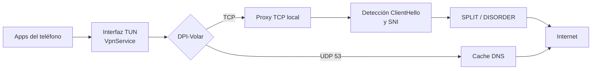
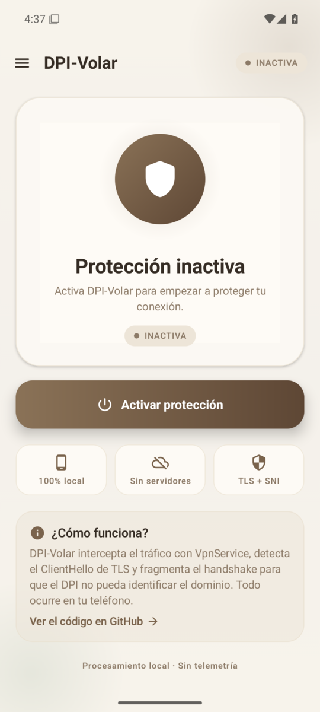
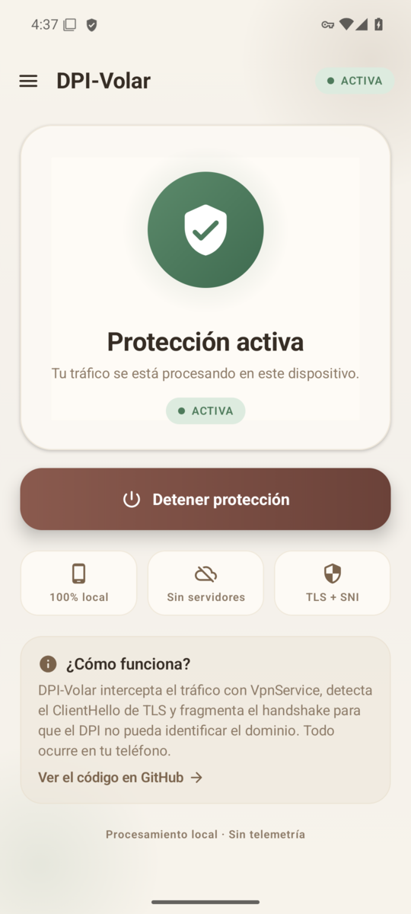
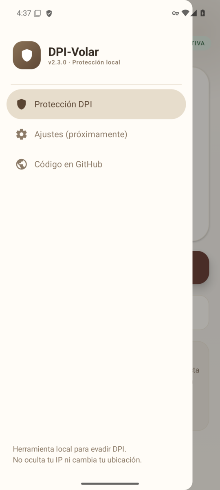
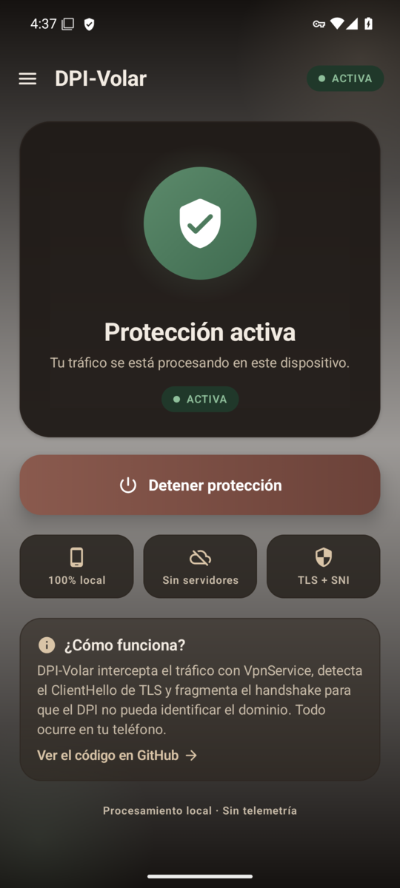

<div align="center">


# DPI-Volar

**Evasión local de Deep Packet Inspection (DPI) en Android.**

Sin servidores. Sin telemetría. Todo el procesamiento ocurre en tu teléfono.

[](https://github.com/PetyaFOSS/DPI-Volar/releases)
[](#cómo-compilar)
[](#)
[](LICENSE)

[](https://github.com/PetyaFOSS/DPI-Volar/releases/download/v2.3.0/DPI-Volar-v2.3.0.apk)

[Descargas](#descargas) · [Cómo funciona](#cómo-funciona) · [Capturas](#capturas) · [Compilar](#cómo-compilar) · [Changelog](CHANGELOG.md)

</div>

---

## Descargas

| Versión | Estado | APK | Cambios |
|:---:|:---:|:---:|---|
| **2.3.0** | Actual | [Descargar](https://github.com/PetyaFOSS/DPI-Volar/releases/download/v2.3.0/DPI-Volar-v2.3.0.apk) | Estado real del servicio, FIN/RST, notificación con acción de parada y rediseño visual. |
| 2.2.0 | Anterior | [Descargar](https://www.mediafire.com/file/kjncklrp2l5je56/DPI_volar.apk/file) | Timeout de sesiones TCP e icono adaptativo. |
| 2.1.0 | Anterior | [Descargar](https://www.mediafire.com/file/2klrkbe8ulmkhar/app-debug.apk/file) | Mejoras de rendimiento, pool de hilos y escrituras a la TUN. |
| 2.0.0 | Anterior | [Descargar](https://www.mediafire.com/file/43jraftynsfnd4a/DPI-VOLARv2.apk/file) | Fragmentación TLS/SNI, rotación de técnicas y cache DNS. |
| 1.0.0 | Anterior | [Descargar](https://www.mediafire.com/file/w9bmv0ilbtb9a43/DPI-VOLAR.apk/file) | Primera versión funcional. |

> Requiere Android 8.0 o superior. El historial completo está en [CHANGELOG.md](CHANGELOG.md).

---

## ¿Qué es DPI-Volar?

DPI-Volar usa el framework `VpnService` de Android para interceptar el tráfico
a nivel de paquetes y manipularlo localmente. No es un proxy ni un túnel hacia
un servidor externo: no envía tu tráfico a ninguna parte y no incluye backend,
cuentas ni telemetría.

Su objetivo es concreto: **dificultar que un sistema de DPI identifique y
bloquee conexiones TLS**. Detecta el `ClientHello`, localiza el campo SNI y
fragmenta el handshake con las técnicas `SPLIT` y `DISORDER`, rotando
automáticamente si una técnica deja de funcionar.

| | VPN comercial | DPI-Volar |
|---|:---:|:---:|
| Servidor externo |  |  |
| Oculta tu IP |  |  |
| Cambia tu ubicación |  |  |
| Procesa el tráfico en tu teléfono |  |  |
| Telemetría o backend | A veces |  |
| Coste | Suscripción | Gratis |

> Tu ISP sigue viendo tu IP real. Lo que cambia es cómo se ve el handshake TLS
> a nivel de paquete, no tu ubicación ni tu identidad.

---

## Características

| | Característica | Detalle |
|:---:|---|---|
|  | **Fragmentación TLS/SNI** | Detecta el `ClientHello` y corta el handshake dentro del nombre del dominio. |
|  | **SPLIT / DISORDER** | Dos técnicas de fragmentación para romper la firma que busca el DPI. |
|  | **Rotación automática** | Cambia de técnica cuando detecta fallos consecutivos contra un destino. |
|  | **Cache DNS** | Evita resolver el mismo dominio una y otra vez al cargar una página. |
|  | **Procesamiento local** | Sin servidores, sin cuentas y sin telemetría. |
|  | **Material 3** | Tema claro/oscuro, tarjeta de estado, animaciones y diseño adaptable. |

---

## Cómo funciona



1. `VpnService` crea una interfaz TUN y recibe los paquetes IPv4 del dispositivo.
2. Cada conexión TCP se reenvía a través de un socket local protegido con `protect()`.
3. En el primer bloque TLS se detecta el `ClientHello` y se localiza el SNI.
4. El handshake se fragmenta (o se envía fuera de orden) para que el DPI no
   encuentre el nombre del dominio en un solo paquete.
5. Las respuestas del servidor vuelven al cliente por la TUN, segmentadas para
   no superar el MTU.

Las consultas DNS por UDP se responden desde una cache local o se reenvían por
un socket protegido. El resto del tráfico UDP todavía no se reenvía.

---

## Capturas

| Protección inactiva | Protección activa |
|:---:|:---:|
|  |  |
| **Menú lateral** | **Modo oscuro** |
|  |  |

---

## Estado del proyecto

- [x] Servicio VPN con interfaz TUN y procesamiento local
- [x] Detección de `ClientHello` y corte consciente del SNI
- [x] Técnicas `SPLIT` y `DISORDER` con rotación automática
- [x] Cache de DNS
- [x] Estado real del servicio observable desde la UI
- [x] Manejo correcto de FIN/RST y cierre de sesiones inactivas
- [x] Notificación con acción para detener la protección
- [x] Rediseño visual con Material 3 y modo oscuro
- [ ] Reenvío UDP general (QUIC/HTTP3, NTP, etc.)
- [ ] Soporte IPv6
- [ ] Stack TCP con ventana, retransmisiones y paquetes fuera de orden
- [ ] Validación de batería y temperatura en dispositivo físico

La v2.3.0 se probó en un emulador Android 15 (API 35): activación desde cero,
permiso VPN, navegación HTTP, descarga de 1 MB, parada desde la app y desde la
notificación, y reactivación. Las pruebas unitarias cubren checksums, paquetes
IPv4/TCP/UDP, parser de SNI y cache DNS.

---

## Cómo compilar

Requisitos:

- Android Studio reciente
- JDK 17 o superior
- SDK de Android 36.1 (el proyecto lo declara en `app/build.gradle.kts`)

```bash
git clone https://github.com/PetyaFOSS/DPI-Volar.git
cd DPI-Volar
```

Compila el APK de depuración:

```bash
./gradlew :app:assembleDebug
```

Ejecuta las pruebas:

```bash
./gradlew :app:testDebugUnitTest
```

El APK queda en `app/build/outputs/apk/debug/app-debug.apk`. También puedes abrir
el proyecto en Android Studio, esperar la sincronización de Gradle y usar el
botón **Run** con un dispositivo o emulador Android 8.0+.

---

## Estructura

```text
app/src/main/java/com/example/dpi_volar/
├── MyVpnService.kt      # Servicio VPN, TUN y ciclo de vida
├── TcpSession.kt        # Proxy TCP y técnicas de evasión
├── TlsParser.kt         # Detección del SNI en el ClientHello
├── Packet.kt            # Parseo IPv4 / TCP / UDP
├── PacketBuilder.kt     # Construcción de paquetes y checksums
├── TunWriter.kt         # Escritura serializada a la TUN
├── DnsCache.kt          # Cache de respuestas DNS
├── VpnState.kt          # Estado observable del servicio
└── ui/theme/            # Tema Material 3 claro/oscuro
```

---

## Contribuir

El proyecto es de código abierto. Puedes hacer fork, abrir issues o enviar pull
requests. Si vas a cambiar la lógica de red, incluye una prueba o una captura de
tráfico que explique el cambio.

## Licencia

MIT — el detalle está en [LICENSE](LICENSE). Los iconos SVG del README están
basados en [Lucide](https://lucide.dev) (ISC).

<div align="center">
  <sub>Hecho para evadir DPI, no para anonimato. Tu IP sigue siendo visible para tu ISP.</sub>
</div>
